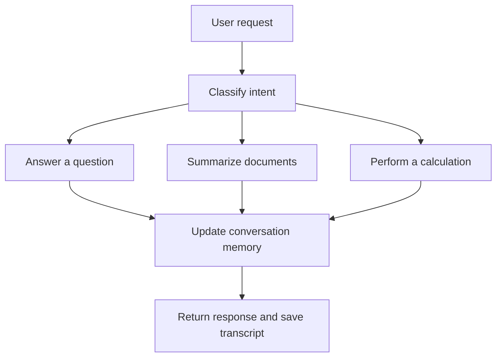

# Document Assistant

**Udacity Nanodegree** · [Agentic AI Engineer with LangChain and LangGraph](https://www.udacity.com/course/agentic-ai-engineer-with-langchain-and-langgraph--nd901)

**Course 1 of 3** · [LangChain Agentic AI Fundamentals](https://www.udacity.com/course/langchain-agentic-ai-fundamentals--cd14639)

A Python assistant that answers questions about local documents, summarizes their contents, and performs arithmetic. This course project demonstrates intent routing in LangGraph, tool calling with LangChain, structured outputs with Pydantic, and short-term conversation memory.

Run it from the terminal, integrate it through the Python API, or explore the workflow in the [interactive Jupyter notebook](notebooks/document_assistant_demo.ipynb).

## Example requests

| Task | Example |
| --- | --- |
| Question answering | What does the Q1 sales report say about monthly revenue? |
| Summarization | Summarize the Q1 sales report. |
| Calculation | Calculate 50000 + 60000 + 70000. |

## Quick start

### 1. Clone and install

Use Git and a recent Python 3 release with `venv` and `pip`. For the tested Python version and Windows activation instructions, see the [installation guide](docs/QUICK_START.md).

```bash
git clone https://github.com/robertishimurasousa/Udacity-Doc-Assistant-Project.git
cd Udacity-Doc-Assistant-Project
python3 -m venv .venv
source .venv/bin/activate
python -m pip install -r requirements.txt
cp .env.example .env
```

### 2. Configure a model provider

The `.env` template uses Vocareum. If you have a course-provided API key, follow the [Vocareum setup guide](docs/VOCAREUM_SETUP.md).

For direct OpenAI access, replace the provider settings in `.env` with the following and remove `OPENAI_BASE_URL` from the file and your shell environment.

```dotenv
API_PROVIDER=openai
OPENAI_API_KEY=your-api-key
DEFAULT_MODEL=gpt-4
DEFAULT_TEMPERATURE=0
```

`gpt-4` is the application default. Use a model available to your account that supports tool calling and structured outputs. See the [configuration reference](docs/CONFIGURATION.md).

### 3. Run the sample

From the repository root, start the assistant with the bundled sales report.

```bash
python main.py data/sales_report_q1_2024.txt
```

Enter one of the [example requests](#example-requests) at the prompt. Use `/stats` to inspect the session and `/quit` to exit.

Without a configured model, you can still load documents and manage sessions from the terminal.

## Architecture



- **Routing and tools.** LangGraph sends each request to a specialized node. The node asks the model which document or calculator tools to call, executes those calls once, and generates a response.
- **Document retrieval.** The document reader uses keyword matching to return up to three documents per call.
- **State and persistence.** Pydantic schemas define the intent and response models. Graph checkpoints stay in memory, while session transcripts are saved as JSON.

See the [implementation guide](docs/IMPLEMENTATION.md) for graph state, tool execution, and session behavior.

## Interfaces

### Terminal

```bash
python main.py ./data
python main.py
```

The terminal scans directories recursively for UTF-8 files with lowercase `.txt`, `.md`, `.json`, and `.csv` extensions. Loading `data/` also includes its README.

| Command | Action |
| --- | --- |
| `/load <path>` | Append documents from a file or directory. |
| `/stats` | Display document and session counts. |
| `/sessions` | List saved session IDs. |
| `/clear` | Start a new conversation and keep saved transcripts on disk. |
| `/help` | Display command help. |
| `/quit` or `/exit` | Exit the application. |

Session restoration is available through the Python API.

### Python

```python
from src.assistant import DocumentAssistant
from src.config import get_default_llm

assistant = DocumentAssistant(
    document_path="data/sales_report_q1_2024.txt",
    llm=get_default_llm(),
)
assistant.load_documents()
print(assistant.query("What does the report say about monthly revenue?"))
```

`query()` returns answer text for Q&A and string representations of the response models for summarization and calculation. See the [API reference](docs/API_REFERENCE.md) for structured state access and session restoration.

### Notebook

Follow the [notebook guide](notebooks/README.md) to set up the kernel and explore queries, tool calls, and sessions interactively.

## Repository layout

```text
.
├── main.py              # Interactive terminal entry point
├── src/                 # Assistant, workflow, retrieval, tools, schemas, prompts
├── data/                # Five sample documents and their documentation
├── docs/                # Setup, reference, architecture, and historical notes
├── notebooks/           # Interactive demonstration
├── tests/               # Automated tests and manual demonstrations
├── sessions/            # JSON conversation transcripts (generated locally)
├── .env.example         # Configuration template
├── pyproject.toml       # Pytest and coverage configuration
└── requirements.txt     # Runtime, notebook, and test dependencies
```

## Testing

Run the focused offline tests for routing, agent behavior, and response schemas from the repository root.

```bash
python -m pytest tests/test_schemas.py tests/test_agents.py tests/test_agent_logic.py -o addopts=""
```

The override runs assertions with the default coverage options disabled. See the [testing guide](docs/TESTING_GUIDE.md) for the coverage threshold and manual provider demonstrations.

## Further reading

- [Documentation index](docs/README.md)
- [Troubleshooting](docs/TROUBLESHOOTING.md)
- [Contributing](CONTRIBUTING.md)
- [Project description and GitHub topics](docs/PROJECT_METADATA.md)

## Data handling and project status

The assistant sends retrieved document text and recent conversation history to the configured model provider. It saves transcripts as plaintext JSON in `sessions/`. Review generated transcripts before committing.

The repository does not currently contain a `LICENSE` file. Earlier course and implementation notes are retained under `docs/` and identified in the documentation index.
